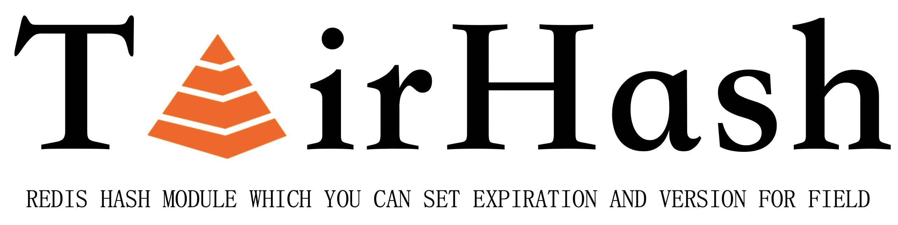

[](https://github.com/alibaba/TairHash/actions/workflows/cmake.yml)
[](https://github.com/alibaba/TairHash/actions/workflows/ci.yml)
[](https://github.com/alibaba/TairHash/actions/workflows/docker-image.yml)
[](https://codecov.io/gh/chenyang8094/TairHash)  


<div align=center>

</div>

## 简介  [英文说明](README.md)
     TairHash是基于redis module开发的一种hash数据结构，和redis原生的hash数据结构相比，TairHash不但和原生hash一样具有丰富的数据接口和高性能，还可以为field设置过期时间和版本，这极大的提高了hash数据结构的灵活性，在很多场景下可以大大的简化业务开发。TairHash提供active expire机制，即使field在过期后没有被访问也可以被主动删除，释放内存。


### 主要的特性如下：

- 支持redis hash的所有命令语义
- field支持单独设置expire和version
- 针对field支持高效的active expire和passivity expire，其中active expire支持SCAN_MODE、SORT_MODE和SLAB_MODE模式。
- 支持field过期删除事件通知（基于pubsub）

## 内存

每个field是一次内存分配，包含名称、值、版本和过期时间，并直接挂在哈希表的链上。一个包含30个field（名称和值均为8字节）的key总共约占1.9KB（`bench/profile.sh`，Redis 7.0，jemalloc），而每个field使用一个dict entry、一个值结构体和两个字符串对象时约为3.9KB。只有当key的某个field设置了过期时间时才会分配过期索引；如果为每个key都分配过期索引，同样的key约占5.2KB。

`MEMORY USAGE` 返回分配器为该key持有的内存：哈希及其field，以及该key自身的过期索引和索引中过期field名称的副本。它不包含SORT_MODE和SLAB_MODE在每个数据库的过期索引中为该key保存的条目，即一个跳表节点和一份key名称的副本（key名称较短时约130字节）。

## 主动过期

### SCAN_MODE（扫描模式）：
- 不对TairHash进行全局排序（可以节省内存）
- 每个TairHash内部依然会使用一个排序索引对fields进行排序（加速每个key内部的field查找）
- 内置定时器会周期使用SCAN命令找到包含过期field的TairHash，然后检查TairHash内部的排序索引，进行field的淘汰
- SCAN会打开访问到的每一个key（无论类型），因此当没有任何TairHash含有设置了过期时间的field时，定时器会跳过扫描
- 排序索引为每个设置了过期时间的field保存一份field名的拷贝，没有设置过期时间的field不在索引中

**支持的redis版本**: redis >= 5.0  
**优点**：可以运行在低版本的redis中（redis >= 5.0 ）      
**缺点**：过期淘汰效率较低（相对SORT模式而言，特别是redis中含有过多的干扰key时）  

**使用方式**：以默认选项执行cmake，并重新编译
### SORT_MODE（排序模式）：

- 使用两级排序索引，第一级对tairhash主key进行排序，第二级针对每个tairhash内部的field进行排序
- 第一级排序使用第二级排序里最小的ttl进行排序，因此主key是按照ttl全局有序的
- 内置定时器会周期扫描第一级索引，找出一部分已经过期的key，然后分别再检查这些key的二级索引，进行field的淘汰，也就是active expire
- 第一级索引为每个key保存一份key名的拷贝，第二级索引为每个设置了过期时间的field保存一份field名的拷贝

**支持的redis版本**: redis >= 7.0  
**优点**：过期淘汰效率比较高      
**缺点**：更多的内存消耗  

**使用方式**：cmake的时候加上`-DSORT_MODE=yes`选项，并重新编译
### SLAB_MODE（slab模式）：

- SLAB模式是一种节省内存，缓存友好，高性能的过期算法
- 和SORT模式一样，也会依赖key的全局排序索引进行过期key的快速查找。和SORT模式不同的是，SLAB不会对key内部的field进行排序索引，相反他们是无序的，这样可以节省索引内存开销‘
- SLAB过期算法使用SIMD指令（当硬件支持时）来加速对过期field的查找

**支持的redis版本**: redis >= 7.0  

**优点**：高效淘汰，低内存消耗，快速访问，为过期算法带来新思路  

**缺点**：更多的内存消耗  

**使用方式**：cmake的时候加上`-DSLAB_MODE=yes`选项，并重新编译

## 主动过期
- 每一次读写field，会触发对这个field自身的过期淘汰操作  
- 每次写一个field时，TairHash也会检查其它field（可能属于其它的key）是否已经过期（每次最多检查3个），因为field是按照TTL排序的，因此这个检查会很高效 (注意: SLAB_MODE暂时不支持这个功能)

## 过期统计
`EXHEXPIREINFO` 返回过期相关的配置和统计：

| 字段 | 含义 |
|---|---|
| `tair_hash_active_expire_mode` | 模块编译时使用的过期模式：`scan`、`sort` 或 `slab` |
| `tair_hash_expiring_keys` | 所有db中至少含有一个待过期field的TairHash key数量 |
| `enable_active_expire` | 主动过期定时器开启时为1 |
| `tair_hash_active_expire_period` | 两次主动过期之间的毫秒数 |
| `tair_hash_active_expire_keys_per_loop` | 每次主动过期在每个db中检查的key数量（SCAN模式下即SCAN的`COUNT`） |
| `tair_hash_active_expire_dbs_per_loop` | 每次主动过期访问的db数量 |
| `tair_hash_active_expire_last_time_msec` / `_max_time_msec` / `_avg_time_msec` | 最近一次、最长和平均一次主动过期的耗时 |
| `tair_hash_passive_expire_keys_per_loop` | 每次写入时顺带淘汰的field数量上限 |
| `db: <n>, active_expired_fields: <a>, passive_expired_fields: <p>` | 每个db中已过期的field数量 |

SORT和SLAB模式下，`INFO tairhash` 也会返回这些统计。

## 事件通知  

tairhash在field发生过期时（由主动或被动过期触发）会发送一个事件通知，通知以pubsub方式发送，channel的格式为：`tairhash@<db>@<key>__:<event>` , 目前只支持expired事件类型，因此
channel为：`tairhash@<db>@<key>__:expired`，消息内容为过期的field。

## 快速开始

```go
127.0.0.1:6379> EXHSET k f v ex 10
(integer) 1
127.0.0.1:6379> EXHGET k f
"v"
127.0.0.1:6379> EXISTS k
(integer) 1
127.0.0.1:6379> debug sleep 10
OK
(10.00s)
127.0.0.1:6379> EXISTS k
(integer) 0
127.0.0.1:6379> EXHGET k f
(nil)
127.0.0.1:6379> EXHSET k f v px 10000
(integer) 1
127.0.0.1:6379> EXHGET k f
"v"
127.0.0.1:6379> EXISTS k
(integer) 1
127.0.0.1:6379> debug sleep 10
OK
(10.00s)
127.0.0.1:6379> EXISTS k
(integer) 0
127.0.0.1:6379> EXHGET k f
(nil)
127.0.0.1:6379> EXHSET k f v  VER 1
(integer) 1
127.0.0.1:6379> EXHSET k f v  VER 1
(integer) 0
127.0.0.1:6379> EXHSET k f v  VER 1
(error) ERR update version is stale
127.0.0.1:6379> EXHSET k f v  ABS 1
(integer) 0
127.0.0.1:6379> EXHSET k f v  ABS 2
(integer) 0
127.0.0.1:6379> EXHVER k f
(integer) 2
```  

## Docker
```
docker run -p 6379:6379 tairmodule/tairhash:latest
```
## 编译及使用

```
mkdir build  
cd build  
cmake ../ && make -j
```
编译成功后会在lib目录下产生tairhash_module.so库文件

```
./redis-server --loadmodule /path/to/tairhash_module.so
```  
编译选项（`cmake -D<选项>=ON ../`）：

| 选项 | 默认值 | 说明 |
|---|---|---|
| `SORT_MODE` / `SLAB_MODE` | `OFF` | 主动过期算法（默认SCAN模式） |
| `TAIRHASH_NATIVE_ARCH` | `OFF` | 针对编译机器的CPU优化（`-march=native`）。仅适用于在运行机器上编译：这样编译的二进制在其他CPU上可能因SIGILL崩溃，例如在CI上构建的Docker镜像。SLAB模式无需开启即可在运行时选择AVX2路径。 |
| `TAIRHASH_LTO` | `OFF` | 链接时优化 |
| `SANITIZER_MODE` | 未设置 | `address`、`undefined` 或 `thread` |
| `GCOV_MODE` | `OFF` | 覆盖率插桩 |

## 测试方法

1. 修改`tests`目录下tairhash.tcl文件中的路径为`set testmodule [file your_path/tairhash_module.so]`
2. 将`tests`目录下tairhash.tcl文件路径加入到redis的test_helper.tcl的all_tests中
3. 在redis根目录下运行./runtest --single tairhash

## 客户端

| language | GitHub |
|----------|---|
| Java     |https://github.com/alibaba/alibabacloud-tairjedis-sdk|
| Python   |https://github.com/alibaba/tair-py|
| Go       |https://github.com/alibaba/tair-go|
| .Net     |https://github.com/alibaba/AlibabaCloud.TairSDK|

## API
[参考这里](CMDDOC-CN.md)

## 我们的modules

[TairHash](https://github.com/alibaba/TairHash): 和redis hash类似，但是可以为field设置expire和version，支持高效的主动过期和被动过期   
[TairZset](https://github.com/alibaba/TairZset): 和redis zset类似，但是支持多（最大255）维排序，同时支持incrby语义，非常适合游戏排行榜场景   
[TairString](https://github.com/alibaba/TairString): 和redis string类似，但是支持设置expire和version，并提供CAS/CAD等实用命令，非常适用于分布式锁等场景  


