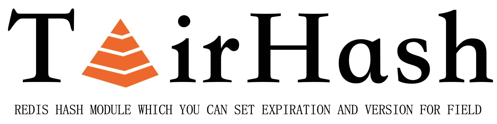

[](https://github.com/alibaba/TairHash/actions/workflows/cmake.yml)
[](https://github.com/alibaba/TairHash/actions/workflows/ci.yml)
[](https://github.com/alibaba/TairHash/actions/workflows/docker-image.yml)
[](https://codecov.io/gh/chenyang8094/TairHash)  


<div align=center>

</div>
   

## Introduction  [中文说明](README-CN.md)
     TairHash is a hash data structure developed based on the redis module. TairHash not only has the same rich data interface and high performance as the native hash, but also can set the expiration and version for the field. TairHash provides an active expiration mechanism, even if the field is not accessed after expiration, it can be actively deleted to release the memory.


### The main features：

- Supports all redis hash commands
- Supports setting expiration and version for field
- Support efficient active expiration (SCAN mode, SORT mode and SLAB mode) and passivity expiration for field
- Support field expired event notification (based on pubsub)
- Supports last-write-wins writes and deletes and source-of-truth sync (`EXHMSETLWW`, `EXHDELLWW`, `EXHSYNCGET`, `EXHSYNCBEGIN`, `EXHSYNC`), so a TairHash can cache an external store without serving a partial or stale copy; see [Last-write-wins and source-of-truth sync](CMDDOC.md#last-write-wins-and-source-of-truth-sync)

## Memory

Each field is one allocation holding its name, value, version, TTL and write sequence, chained
directly into the hash table. A key of 30 fields with 8-byte names and values takes 2088 bytes
in all (`MEMORY USAGE`, Redis 7.0, jemalloc), against about 3.9KB with one dict entry, value
struct and two string objects per field. TairHash 2.0 took 1848 bytes for it: the write
sequence adds 8 bytes to each field, which the allocator charges as 8 bytes for a field of up
to 64 bytes in all, and as nothing or as a whole size class (16 bytes up to 128, 32 up to 256)
for a larger one. The expire index is allocated only once a field of the key gets a TTL;
allocated with every key, it took the same key to about 5.2KB in TairHash 2.0.

`MEMORY USAGE` reports what the allocator holds for a key: the hash with its fields and
tombstones, and the key's own expire index with its copies of the names of expiring fields.
It does not count the key's entry in the per-database expire index of SORT_MODE and
SLAB_MODE, a skiplist node and a copy of the key name (about 130 bytes for a short name).

## Active expiration
### SCAN_MODE:
- Do not sort TairHash globally (Smaller memory overhead)
- Each TairHash will still use a sort index to sort the fields internally (For expiration efficiency)
- The built-in timer will periodically use the SCAN command to find the TairHash that contains the expired field, and then check the sort index inside the TairHash to eliminate the field
- A scan opens every key it visits, whatever its type, so the timer skips it while no TairHash has a field with a TTL
- The sort index holds its own copy of the name of each field that has a TTL; a field without a TTL is not in it

**Supported redis version**: redis >= 5.0

**Advantages**: can run in the low version of redis (redis >= 5.0)  

**Disadvantages**: low efficiency of expire elimination (compared with SORT mode and SLAB mode)  

**Usage**: cmake with `-DTAIRHASH_EXPIRE_MODE=scan`, and recompile

### SORT_MODE (default):
- Use a two-level sort index, the first level sorts the main key of tairhash, and the second level sorts the fields inside each tairhash
- The first-level uses the smallest ttl in the second-level for sorting, so the main key is globally ordered
- The built-in timer will periodically scan the first-level index to find out a key that has expired, and then check the secondary index of these keys to eliminate the expired fields. This is the active expire
- The first-level index holds its own copy of each key name, and the second-level index its own copy of the name of each field that has a TTL

**Supported redis version**: redis >= 7.0

**Advantages**: higher efficiency of expire elimination     

**Disadvantages**: More memory consumption  

**Usage**: the default build; `-DTAIRHASH_EXPIRE_MODE=sort` selects it explicitly

### SLAB_MODE：  
- Slab mode is a low memory usage (compared with SORT mode), cache-friendly, high-performance expiration algorithm
- Like SORT mode, keys are globally sorted to ensure that keys that need to be expired can be found faster. Unlike SORT mode, SLAB does not sort the fields inside the key, which saves memory overhead. 
- The SLAB expiration algorithm uses SIMD instructions (when supported by the hardware) to speed up the search for expired fields

**Supported redis version**: redis >= 7.0  

**Advantages**: Efficient elimination, low memory consumption, and fast access bring new ideas to expiration algorithms   

**Disadvantages**: More memory consumption    

**Usage**: cmake with `-DTAIRHASH_EXPIRE_MODE=slab`, and recompile

## Passivity expiration  
- Every time you read or write a field, it will also trigger the expiration of the field itself  
- Every time you write a field, tairhash also checks whether other fields (may belong to other keys) are expired (currently up to 3 at a time), because fields are sorted by TTL, so this check will be very efficient (Note: SLAB_MODE does not support this feature)

## Expiration statistics
`EXHEXPIREINFO` reports how expiration is configured and what it has done:

| Field | Meaning |
|---|---|
| `tair_hash_active_expire_mode` | Expire mode the module was built with: `scan`, `sort` or `slab` |
| `tair_hash_expiring_keys` | TairHash keys, across all databases, with at least one field waiting to expire |
| `enable_active_expire` | 1 when the active expire timer runs |
| `tair_hash_active_expire_period` | Milliseconds between active expire passes |
| `tair_hash_active_expire_keys_per_loop` | Keys a pass examines in each database (SCAN mode: the SCAN `COUNT`) |
| `tair_hash_active_expire_dbs_per_loop` | Databases a pass visits |
| `tair_hash_active_expire_last_time_msec` / `_max_time_msec` / `_avg_time_msec` | Duration of the last, longest and average pass |
| `tair_hash_passive_expire_keys_per_loop` | Most fields a write expires along the way |
| `db: <n>, active_expired_fields: <a>, passive_expired_fields: <p>` | Fields expired in each database |

SORT and SLAB builds also report these in `INFO tairhash`.


## Event notification   

tairhash will send an event notification when the field expires (triggered by active or passive expiration). The notification is sent in pubsub mode. The format of the channel is: `tairhash@<db>@<key>__:<event>` , currently only supports expired event type, so
The channel is: `tairhash@<db>@<key>__:expired`, and the message content is the expired field.

## Quick Start

```go
127.0.0.1:6379> EXHSET k f v ex 10
(integer) 1
127.0.0.1:6379> EXHGET k f
"v"
127.0.0.1:6379> EXISTS k
(integer) 1
127.0.0.1:6379> debug sleep 10
OK
(10.00s)
127.0.0.1:6379> EXISTS k
(integer) 0
127.0.0.1:6379> EXHGET k f
(nil)
127.0.0.1:6379> EXHSET k f v px 10000
(integer) 1
127.0.0.1:6379> EXHGET k f
"v"
127.0.0.1:6379> EXISTS k
(integer) 1
127.0.0.1:6379> debug sleep 10
OK
(10.00s)
127.0.0.1:6379> EXISTS k
(integer) 0
127.0.0.1:6379> EXHGET k f
(nil)
127.0.0.1:6379> EXHSET k f v  VER 1
(integer) 1
127.0.0.1:6379> EXHSET k f v  VER 1
(integer) 0
127.0.0.1:6379> EXHSET k f v  VER 1
(error) ERR update version is stale
127.0.0.1:6379> EXHSET k f v  ABS 1
(integer) 0
127.0.0.1:6379> EXHSET k f v  ABS 2
(integer) 0
127.0.0.1:6379> EXHVER k f
(integer) 2
```  

## Docker
```
docker run -p 6379:6379 tairmodule/tairhash:latest
```
## BUILD

```
mkdir build  
cd build  
cmake ../ && make -j
```
then the tairhash_module.so library file will be generated in the lib directory

Build options (`cmake -D<option>=<value> ../`):

| Option | Default | Description |
|---|---|---|
| `TAIRHASH_EXPIRE_MODE` | `sort` | Active expire algorithm: `sort`, `slab` or `scan` (see [Active expiration](#active-expiration)). `sort` and `slab` need Redis 7.0+ or Valkey; `scan` also runs on Redis 5.0 and 6.x. `SORT_MODE` and `SLAB_MODE` are deprecated but still honoured when `TAIRHASH_EXPIRE_MODE` is not set: `ON` selects that mode, and an explicit `OFF` builds `scan`, as it did before. |
| `TAIRHASH_NATIVE_ARCH` | `OFF` | Optimize for the build host's CPU (`-march=native`). Only for a library built on the host that runs it: a binary built this way can crash with SIGILL on another CPU, for example a Docker image built on a CI runner. SLAB mode picks its AVX2 path at runtime without it. |
| `TAIRHASH_LTO` | `OFF` | Link-time optimization |
| `SANITIZER_MODE` | unset | `address`, `undefined` or `thread` |
| `GCOV_MODE` | `OFF` | Coverage instrumentation |

```
./redis-server --loadmodule /path/to/tairhash_module.so
```  

## Module options

Pass options as `name value` pairs after the module path, for example
`--loadmodule /path/to/tairhash_module.so replication_format compat`.

| Option | Type | Default | Description |
|---|---|---|---|
| `enable_active_expire` | 0 or 1 | `1` | Run the active expire timer. Without it fields expire only passively, when accessed. |
| `active_expire_period` | milliseconds | `1000` | Interval between active expire cycles. |
| `active_expire_keys_per_loop` | integer | `1000` | Keys (SCAN mode: the SCAN count) examined per database per active expire cycle. |
| `active_expire_dbs_per_loop` | integer | `16` | Databases visited per active expire cycle. |
| `passive_expire_keys_per_loop` | integer | `3` | Expired fields removed per passive expiry check. |
| `lww_tombstone_ttl` | seconds | `3600` | How long a tombstone left by `EXHDELLWW` holds off writes with the same or a lower version. Make it longer than a delete can take to overtake the writes it supersedes. It must not be shorter than `sync_lease_ttl`, so that a tombstone outlives a sync whose snapshot was read before the delete; the module refuses to load otherwise. |
| `sync_lease_ttl` | seconds | `60` | How long an `EXHSYNCBEGIN` lease, and the placeholder it creates for a missing key, lasts. Make it longer than reading a snapshot from the source takes. |
| `replication_format` | `state` or `compat` | `state` | How writes reach replicas and the AOF: `state` sends one internal `EXHMSETREPL` (or `EXHMETAREPL`) per write, `compat` one `EXHSET`/`EXHSETNX` per field, which TairHash 1.x also accepts. See [Upgrading from 1.x](#upgrading-from-1x). On Redis 7.0+ and Valkey it is also the module config `tairhash.replication_format`, which `CONFIG SET` changes at runtime; a value for it in the config file takes precedence over the load argument. |

## Upgrading from 2.0

TairHash 2.1 writes RDB encoding version 1 (sync state, tombstones and per-field write
sequence, plus the sync epoch as module aux data, so its RDBs need the module loaded even
without TairHash keys) and still loads version 0: TairHash 2.0 cannot load an RDB that 2.1
wrote, so upgrade replicas before their master and keep a pre-upgrade RDB if a downgrade
must stay possible. 2.1 replicates with `EXHMSETREPL` layout 2, which 2.0 rejects; run 2.1
with `replication_format compat` until every node runs it, as for an upgrade from 1.x below.

## Upgrading from 1.x

TairHash 2.x replicates each write as one `EXHMSETREPL` or `EXHMETAREPL`, which TairHash 1.x
does not know: a 1.x replica of a 2.x master logs an error for every write and drops it. A
write inside a MULTI/EXEC or a script takes the rest of that transaction with it, commands
on other keys and of other types included: the replica aborts a transaction that holds a
command it does not know. 2.0 keeps the RDB encoding of 1.x; 2.1 writes a new one, with the
write sequence and the sync state, that 1.x and 2.0 cannot load, so a node older than 2.1
cannot do a full sync from a 2.1 node. Upgrade with `replication_format compat` until every
node runs 2.x:

1. Start every upgraded node with `replication_format compat` (on Redis 7.0+ and Valkey,
   `tairhash.replication_format compat` in the config file works too). Upgrade replicas
   first, fail over, then upgrade the former masters: a 1.x node may then replicate from a
   2.x node during the failover, which `compat` keeps working (from a 2.1 node only as long
   as it needs no full sync, see above).
2. Confirm that `MODULE LIST` reports `ver 20100` for `tairhash` on every node, including
   chained replicas: a replica passes its master's stream on unchanged, so replicas at
   every depth receive what the top-level master sends.
3. Switch every node to `state`: `CONFIG SET tairhash.replication_format state` on Redis
   7.0+ and Valkey, or a restart without the option on older servers.

To downgrade, switch every node back to `compat` first, then run `BGREWRITEAOF` on each
node so that its AOF holds no `EXHMSETREPL` or `EXHMETAREPL`, and replace the module. A
node still in `state` writes what it applies from its master to its own AOF in the state
format. `EXHMSETLWW`, `EXHDELLWW` and `EXHSYNC` replicate in the state format whatever the
setting, a master on which a hash has been synced announces its sync epochs with
`EXHSYNCEPOCH`, and AOF rewrite emits `EXHSYNCREPL` and `EXHTOMBREPL` for hashes with sync
state or tombstones in both formats, so none of these can reach a node older than 2.1. On
Redis 7.0+ and Valkey, setting `propagation-error-behavior panic-on-replicas` during the
upgrade makes a replica that cannot apply the stream stop instead of silently diverging.

`EXHSETNX` now starts a new field at version 1, as `EXHSET` does; 1.x left it at 0, so a
later `VER` check failed for every version but 0. Applied from the replication stream or
the AOF, `EXHSETNX` still leaves the field at version 0: that is what a 1.x master and the
`compat` format mean by it. On a server older than Redis 6.0.9 the module cannot tell where
a command comes from, and the field starts at version 1 there too.

A default build now uses SORT mode instead of SCAN mode, so it no longer loads on servers older
than Redis 7.0: build those with `-DTAIRHASH_EXPIRE_MODE=scan`. Switching modes needs no data
migration, since the RDB encoding is the same in every mode.
## TEST

1. Modify the path in the tairhash.tcl file in the `tests` directory to `set testmodule [file your_path/tairhash_module.so]`
2. Add the path of the tairhash.tcl file in the `tests` directory to the all_tests of redis test_helper.tcl
3. run ./runtest --single tairhash


## Client

| language | GitHub |
|----------|---|
| Java     |https://github.com/alibaba/alibabacloud-tairjedis-sdk|
| Python   |https://github.com/alibaba/tair-py|
| Go       |https://github.com/alibaba/tair-go|
| .Net     |https://github.com/alibaba/AlibabaCloud.TairSDK|

## API
[Reference](CMDDOC.md)


### Our modules
[TairHash](https://github.com/alibaba/TairHash): A redis module, similar to redis hash, but you can set expire and version for the field  
[TairZset](https://github.com/alibaba/TairZset): A redis module, similar to redis zset, but you can set multiple scores for each member to support multi-dimensional sorting  
[TairString](https://github.com/alibaba/TairString): A redis module, similar to redis string, but you can set expire and version for the value. It also provides many very useful commands, such as cas/cad, etc.  
